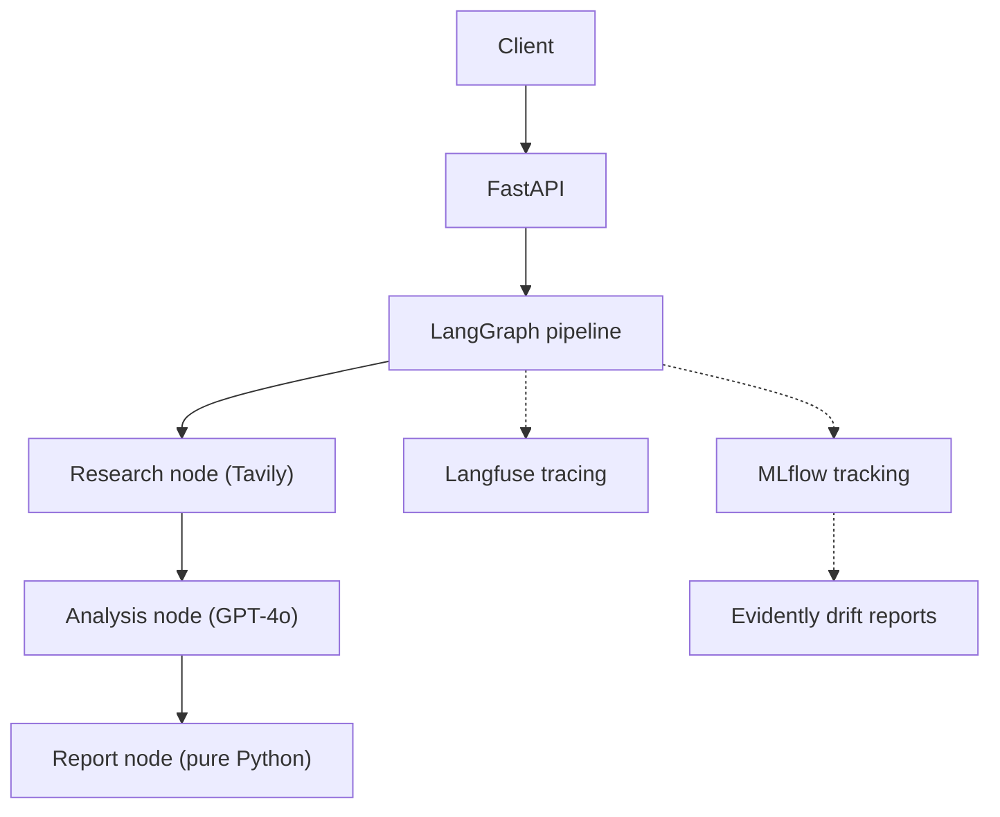

# MarketScope

Multi-agent competitive intelligence system, built with production MLOps practices.

Give it a company name and a LangGraph pipeline researches the web, analyzes the competitive landscape, and returns a structured report. It currently targets 20 global tech companies (Tesla, Nvidia, Microsoft, and others).

**Live demo:** *Deployment in progress (Render)*

## Highlights

- Multi-agent pipeline built on LangGraph and served through FastAPI
- Deterministic CI: frozen search fixtures, so test failures mean code problems, not news cycles
- LLM-as-judge evaluation with DeepEval (Faithfulness and Answer Relevancy)
- Experiment tracking with MLflow and output drift monitoring with Evidently
- Request tracing with Langfuse
- Fully containerized with Docker

## Architecture



## Engineering decisions

**1. Deterministic tests.** Early tests hit the live Tavily API. News changes hourly, so CI was flaky and a failure could mean either a code bug or a different search result. I replaced live calls with 20 frozen JSON fixtures in `mocks/`, which separates agent logic from live data.

**2. CI cost control.** Judging all 20 companies with a GPT-4o judge on every push cost about $0.45 per run. The PR gate now runs a targeted set of six edge cases ("Danger 6") and checks an aggregate mean score, which cut CI cost by about 85% (about $0.12 per run). Full coverage moved to a separate live smoke test.

**3. Removing a hallucination source.** The report-formatting step was hallucinating financial figures. I removed the LLM from that step and replaced it with plain Python string formatting. This eliminated that failure mode and saved tokens.

**4. Reproducible experiment tracking.** The MLflow container runs with `--serve-artifacts`, so clients upload artifacts over HTTP instead of writing to local disk.

## Tech stack

| Area | Tools |
|---|---|
| Orchestration and API | LangGraph, LangChain, FastAPI |
| Models | OpenAI GPT-4o (agent and judge) |
| Evaluation | DeepEval, Pytest |
| Observability | Langfuse, MLflow, Evidently |
| DevOps | Docker, Docker Compose, GitHub Actions |

## Getting started

**Prerequisites:** Python 3.13+, Docker Desktop, OpenAI and Tavily API keys.

```bash
git clone https://github.com/siddharthreddy1515-ai/marketscope.git
cd marketscope
cp .env.example .env    # then add your API keys
docker compose up --build
```

| Service | URL |
|---|---|
| API | http://localhost:8000/api/v1/analyze |
| MLflow dashboard | http://localhost:8080 |

### Example request

```bash
curl -X POST http://localhost:8000/api/v1/analyze \
  -H "Content-Type: application/json" \
  -d '{"company_name": "Tesla"}'
```

### Run the tests

```bash
MOCK_TAVILY=true pytest test_agent.py
```

On Windows PowerShell: `$env:MOCK_TAVILY="true"; pytest test_agent.py`

## Monitoring

**Experiment tracking.** Logs latency (average about 4.4s), token cost, and eval scores to MLflow:

```bash
MLFLOW_TRACKING_URI=http://localhost:8080 MOCK_TAVILY=true python run_experiment.py
```

**Drift detection.** Compares current outputs against `baseline_reports.csv` and writes an HTML report:

```bash
python evidently_monitor.py
```

## CI/CD

| Workflow | Trigger | What it does |
|---|---|---|
| `ci.yml` | Pull requests | Runs the "Danger 6" companies against mocks. Blocks merge if mean Faithfulness or Relevancy drops below 0.85. |
| `live-smoke.yml` | Every 3 days | Runs all 20 companies against live Tavily to catch external API drift. |

## Environment variables

| Variable | Purpose |
|---|---|
| `OPENAI_API_KEY` | LLM calls |
| `TAVILY_API_KEY` | Web search |
| `LANGFUSE_PUBLIC_KEY`, `LANGFUSE_SECRET_KEY`, `LANGFUSE_HOST` | Tracing |
| `MOCK_TAVILY` | `true` for tests, `false` for live search |

## Project structure

```text
marketscope/
├── .github/workflows/     CI gate and live smoke test
├── mocks/                 20 frozen Tavily responses
├── baseline_reports.csv   Reference outputs for drift monitoring
├── companies.py           The 20 target companies
├── main.py                FastAPI app
├── workflow.py            LangGraph pipeline
├── test_agent.py          DeepEval test suite
├── run_experiment.py      MLflow tracking script
├── evidently_monitor.py   Drift report generator
├── Dockerfile             API container
├── Dockerfile.mlflow      MLflow server container
└── docker-compose.yml     Full stack
```

## Author

Siddharth · `[LinkedIn](https://www.linkedin.com/in/siddharth-donuru-816413290) | [GitHub](https://github.com/siddharthreddy1515-ai)`